# Causal graph — detector stages and four-corner recall

Built with the pure-MoonBit DoWhy port **`riantr/moonbit_dowhy@0.0.33`**
(the requested `riantr/dowhy@latest` does not exist in the registry).
The graph is a **domain DAG**, not a learned graph; `U` is an unobserved
image-difficulty node. Identification is run on the **observed projection**
(U removed), so every adjustment set below assumes no hidden confounding.

## Graph



Nodes: `W` image geometry, `Ngt` GT-box count, `Red` red annotation coverage,
`Ovl` GT overlap density; `S1` red mask, `S2` denoise, `S3` holes/outer
contours, `S4` hole quad fit, `S5` edgefit, `S6` side refine, `S7` side-validity
gate, `S8` orthogonality + edge rule, `S9` red-support gate, `S10` dedup;
`Y` four-corner recall @ D=5; `U` latent difficulty.

## Backdoor adjustment sets (MoonBit DoWhy, observed projection)

| treatment | backdoor key | adjustment set |
|---|---|---|
| S1 | backdoor2 | Red |
| S2 | backdoor2 | S1 |
| S3 | backdoor2 | S2, Ngt, Ovl |
| S4 | backdoor2 | W, S3, Ovl |
| S5 | backdoor2 | W, S3 |
| S6 | backdoor2 | S4 |
| S7 | backdoor2 | S4, S5 |
| S8 | backdoor3 | S3, Ovl |
| S9 | backdoor3 | Ngt, Ovl |
| S10 | backdoor2 | S9 |

## What the graph encodes (evidence labels)

- **Supported:** `Ovl -> Y` (OR2 P2-a: overlapping GT is detected at 66.0% vs 95.3%; theta −0.18 TP/img, p≈3e-9). `Red -> S1` (the hue 0–4 window is the mask fix; wide hue is harmful). `S3 -> S4/S5 -> S7 -> S8 -> S9 -> S10 -> Y` is the shipped pipeline order.
- **Ceiling:** the oracle GT-stroke mask is **+109 TP** (1010 vs 901 at D=5), so the mask-to-candidate path is the largest causal headroom; it is not a deployable arm.
- **Estimator-sensitive (do not over-read):** the six-stage panel's `S2` effect loses significance under the MoonBit linear PLR (LOOP-45: 2/6 replicate); `S3`/`S5`/`S6` flip sign or significance. The graph is the hypothesis; the DoubleML estimates are the evidence.
- **Measured inert:** the orthogonality factor (`S8`) is causally inert (OR2: edge p=0.91, blend p=0.55, joint p=0.28, tol p=0.07); only the edge-band rule (`t_band`) moves, and that is a GT-rule/detection-rule mismatch.
- **Binding gate:** admission (`S9`) is the binding constraint — in the S1–S6 loop only 311 of 936 YOLO proposals passed the gates; the proposal source was not the limit.
- **Neutral:** dedup (`S10`) measured +0 TP / +0 trueFP in the S4 experiment.

## Caveats

- `U` is latent; the adjustment sets above are for the observed projection. Any hidden image-difficulty confounding can still bias the stage effects.
- Stage features are post-treatment outputs; a stage's adjustment set is not a licence to read its coefficient as an intervention.
- Do not re-run `card`/`side3`/`local`, fragment merging, cut-side sliding, joint re-fitting, global hue widening, or per-image config selection — all measured dead.

## Regenerate

```bash
python proto/causal_graph.py
```
